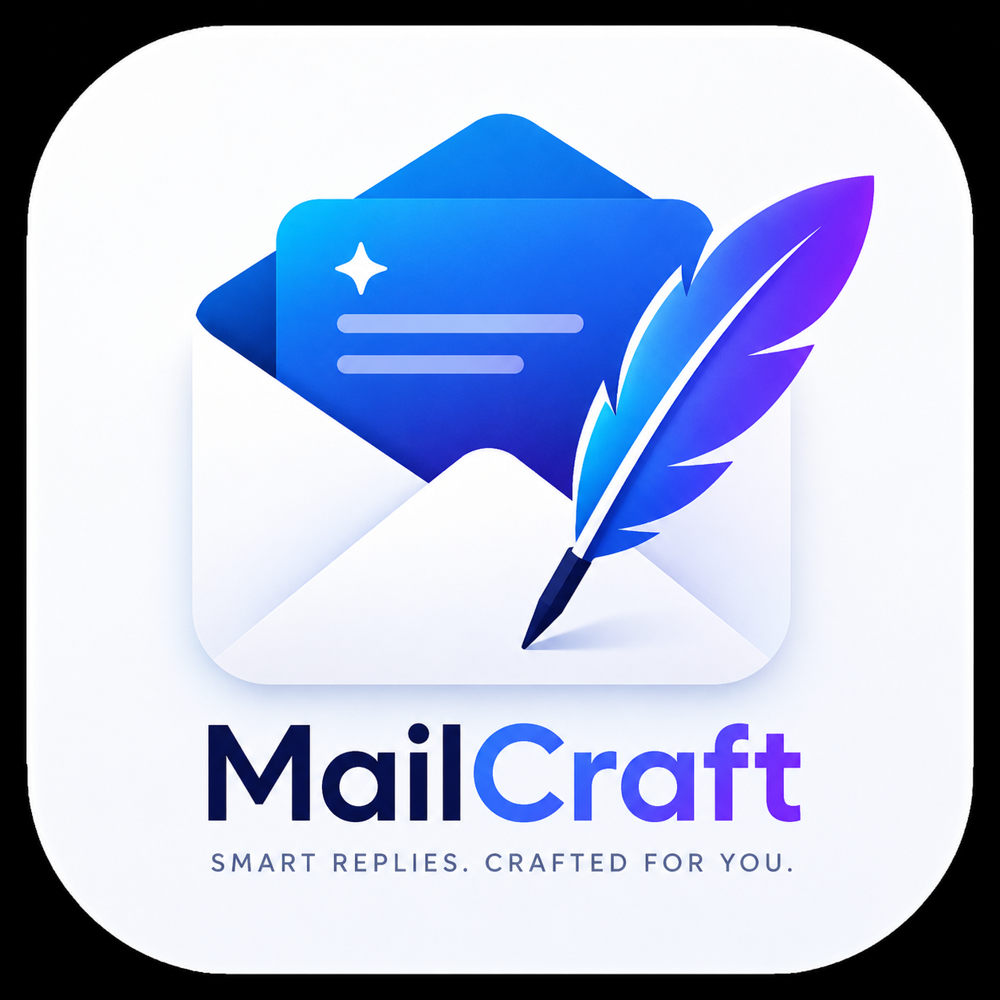

MailCraft — AI Email Reply Generator

MailCraft generates email replies with a chosen tone. It includes a React web interface, a Spring Boot API that forwards requests to the Gemini API, and a Chrome extension that adds a **Generate Reply** button to Gmail compose toolbars.



## What is implemented

- A React form for entering the original email, choosing `professional`, `casual`, or `friendly` tone, generating a reply, and copying it to the clipboard.
- A Spring Boot endpoint, `POST /api/email/generate`, which builds an email-reply prompt and calls the configured Gemini API endpoint.
- A 30-second upstream API timeout and forwarding of Gemini HTTP error details from the backend.
- A Chrome Manifest V3 content script that observes Gmail for compose windows, injects a **✨ Generate Reply** button, reads the currently displayed email, and inserts the generated reply into Gmail’s compose editor.
- CORS enabled for the backend endpoint so the React app and extension can call it during local development.

## How it works

```text
React app or Gmail extension
          |
          | POST /api/email/generate
          v
Spring Boot API (localhost:8080)
          |
          | prompt + Gemini API key
          v
Configured Gemini interactions endpoint
          |
          v
Generated plain-text reply
```

1. The client sends `emailContent` and an optional `tone`.
2. `EmailGeneratorService` creates a prompt asking for a professional email reply; when supplied, it adds the selected tone.
3. The service sends `{ "model": "gemini-3.6-flash", "input": "..." }` to `/v1beta/interactions` on `GEMINI_API_URL`, authenticating with the `x-goog-api-key` header.
4. It finds the `model_output` text block in the API response and returns it as plain text.
5. The web app displays that text, while the Gmail extension inserts it into the active compose box.

## Requirements

- Java 21 (as configured in `pom.xml`)
- Node.js and npm (current LTS recommended)
- Google Chrome for the extension
- A Gemini API key and an API base URL compatible with the `POST /v1beta/interactions` request used by the service
- Internet access for the backend to reach the configured Gemini endpoint

The backend requires these environment variables:

```text
GEMINI_API_URL=<Gemini API base URL; do not include /v1beta/interactions>
GEMINI_API_KEY=<your Gemini API key>
```

Do not commit the API key. `application.properties` reads both values from environment variables rather than storing secrets in source control.

## Run locally

### 1. Configure Gemini credentials

PowerShell example for the current terminal:

```powershell
$env:GEMINI_API_URL = "https://your-gemini-api-host"
$env:GEMINI_API_KEY = "your-api-key"
```

Replace the URL with the base URL expected by the Gemini API integration being used. The application itself appends `/v1beta/interactions`.

### 2. Start the backend

```powershell
cd backend/email_writer
.\mvnw.cmd spring-boot:run
```

The API starts on `http://localhost:8080` by default.

### 3. Start the web app

Open a second terminal:

```powershell
cd frontend/my-react-app
npm install
npm run dev
```

Open the local URL printed by Vite (typically `http://localhost:5173`). Enter an email, optionally select a tone, then choose **Generate Reply**.

### 4. Load the Chrome extension

1. Keep the backend running on port `8080`.
2. Open `chrome://extensions` in Chrome.
3. Enable **Developer mode**.
4. Choose **Load unpacked**.
5. Select the `chrome-extension` folder in this project.
6. Open Gmail, open or start a reply, and use **✨ Generate Reply** in the compose toolbar.

## API

### `POST /api/email/generate`

Request body:

```json
{
  "emailContent": "Could you send the report by Friday?",
  "tone": "professional"
}
```

`tone` is optional. The endpoint returns the generated email reply as a plain-text response.

Example:

```powershell
Invoke-RestMethod -Method Post `
  -Uri "http://localhost:8080/api/email/generate" `
  -ContentType "application/json" `
  -Body '{"emailContent":"Could you send the report by Friday?","tone":"professional"}'
```

## Project structure

```text
Spring-email-project/
├── backend/
│   └── email_writer/
│       ├── pom.xml                         # Spring Boot, Web MVC/WebFlux, Lombok
│       ├── mvnw.cmd                        # Maven wrapper for Windows
│       └── src/
│           ├── main/
│           │   ├── java/com/email/email_writer/
│           │   │   ├── EmailWriterApplication.java     # Application entry point
│           │   │   ├── EmailGeneratorController.java   # POST API controller
│           │   │   ├── EmailGeneratorService.java      # Prompting and Gemini request
│           │   │   ├── EmailRequest.java               # Request DTO
│           │   │   └── WebClientConfig.java            # WebClient builder bean
│           │   └── resources/application.properties    # Environment-backed Gemini config
│           └── test/.../EmailWriterApplicationTests.java
├── frontend/
│   └── my-react-app/
│       ├── package.json                     # Vite scripts and React dependencies
│       └── src/
│           ├── App.jsx                      # Email reply generator UI
│           ├── App.css                      # Present but currently empty
│           ├── index.css                    # Present but currently empty
│           └── main.jsx                     # React entry point
├── chrome-extension/
│   ├── manifest.json                        # Manifest V3 definition
│   ├── content.js                           # Gmail button injection and reply insertion
│   ├── content.css                          # Present but currently empty
│   └── mailcraft-extensions.png             # MailCraft icon
└── README.md
```

## Technology used

- Frontend: React 19, Vite, Material UI, Axios
- Backend: Java 21, Spring Boot 4, Spring Web MVC, Spring WebFlux `WebClient`, Lombok, Maven
- Browser integration: Chrome Extension Manifest V3, Gmail DOM integration
- AI provider: Gemini API, configured through environment variables

## Current limitations and notes

- The frontend calls `http://localhost:8080` directly. A production deployment needs a configurable API URL and a secure deployment architecture.
- The Gmail DOM selectors in `content.js` depend on Gmail’s markup and may need updates if Gmail changes its UI.
- The extension manifest declares `mailcraft.html` as its popup, but that file is not currently present in `chrome-extension/`. The Gmail content script can still be the primary feature, but Chrome will not be able to open the declared popup until the file is added or the `default_popup` entry is removed.
- `App.css`, `index.css`, and `content.css` exist but currently contain no styles; the React UI styling is provided through Material UI props.
- The backend returns upstream or parsing failures as runtime errors. User-friendly backend error responses and input validation are not yet implemented.

## Useful commands

```powershell
# Backend tests
cd backend/email_writer
.\mvnw.cmd test

# Frontend lint
cd frontend/my-react-app
npm run lint

# Frontend production build
npm run build
```
